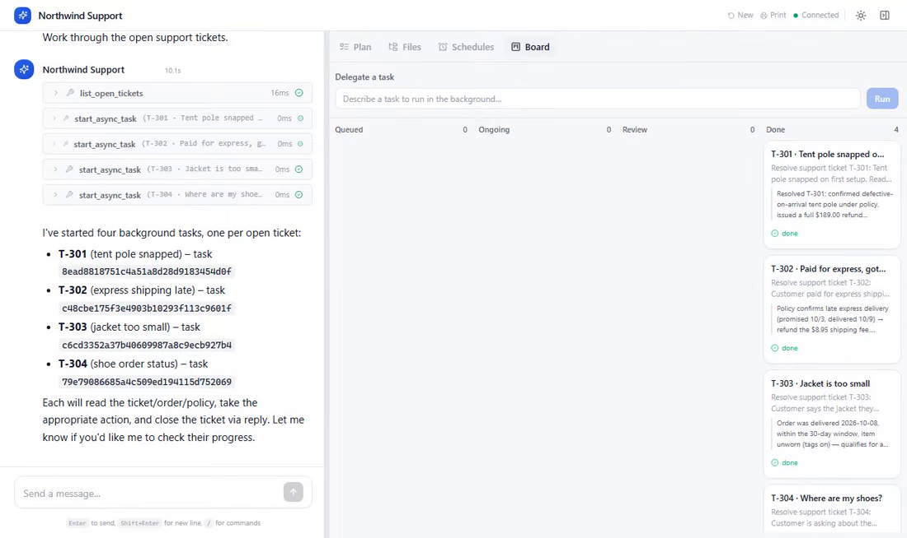
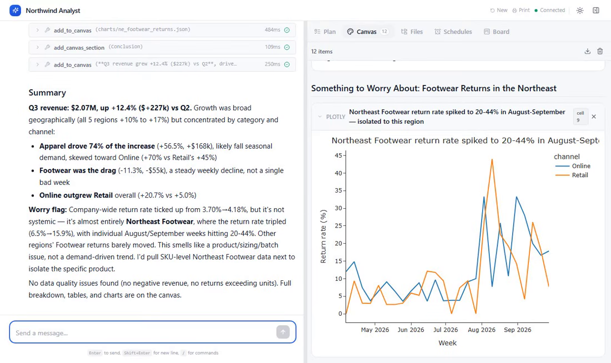
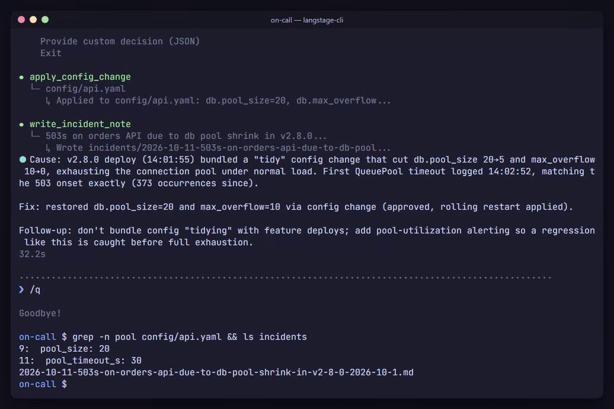

# Gallery

Real agents doing real work, on the stage that suits each job. Every example is a small
LangGraph agent you can read in one sitting, with the data it works on, so you can run
it yourself and then swap in your own tools.

These aren't the keyless demos used elsewhere in the docs. Each one runs a real model,
Claude Sonnet 5, unscripted, recorded in one take. The only editing is that long waits
on the model are shortened; each page says by how much.

-   

    **[Support triage with approvals](support-triage.md)**

    Web app · Board · human-in-the-loop

    A support agent works four tickets in parallel and waits for a manager to approve
    a $189 refund.

-   

    **[Sales analyst](sales-analyst.md)**

    Web app · Python · inline charts · Canvas

    An analyst agent answers "what drove Q3?" from a year of sales data, with charts
    and a written report.

-   

    **[Incident investigator](incident-investigator.md)**

    Terminal · log search · approval menu

    An on-call agent traces a spike of 503s to a bad deploy, fixes the config once
    you approve, and writes the incident note.

## What they have in common

- **Bring your own agent.** Each one is a plain `create_agent(...)` graph with a
  handful of tools. LangStage doesn't ask you to build it a special way; you point a
  stage at it with `--agent agent.py:graph`.
- **A human where it matters.** Refunds over $100 and production config changes pause
  with LangGraph's `interrupt()`. LangStage shows the request and the decisions it
  allows in whichever stage you're using: the web app's dialog or Board, or the
  terminal's approval menu. See [Human-in-the-loop](../guides/human-in-the-loop.md).
- **Real files.** The agents read and write a workspace you can open: tickets and
  replies, a CSV and its charts, logs and an incident note.

The source for every example, and the scripts that recorded them, are in the docs
repository under
[`gallery/`](https://github.com/dkedar7/langstage-docs/tree/main/gallery) and
[`demos/gallery/`](https://github.com/dkedar7/langstage-docs/tree/main/demos/gallery).
