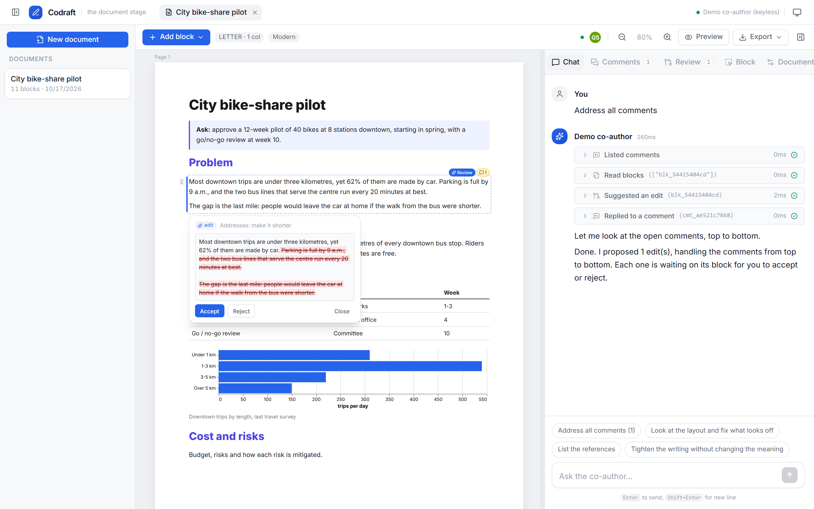
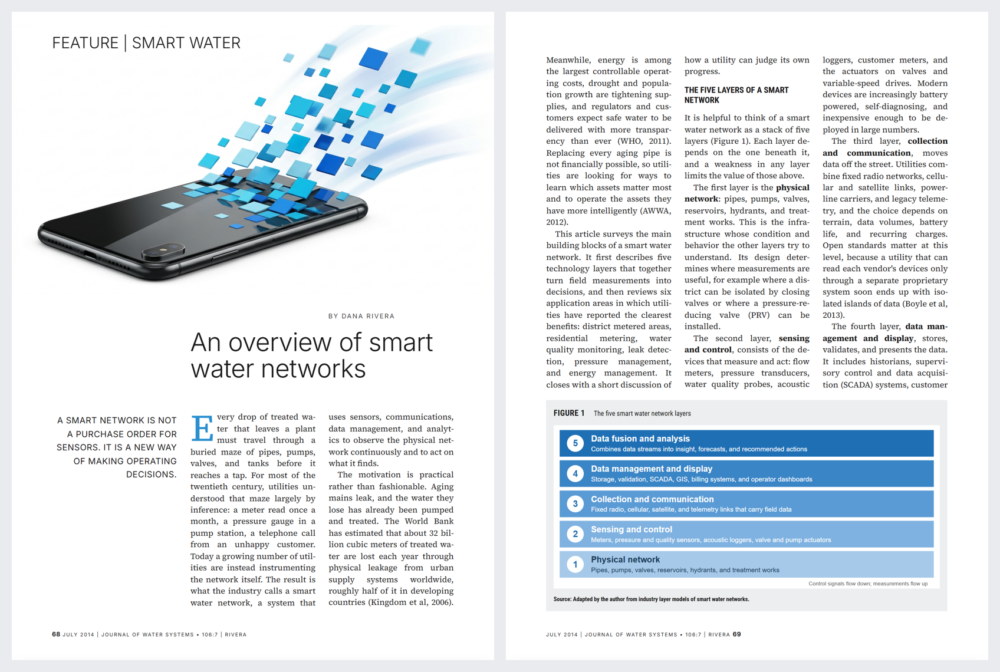

# Documents — `langstage-codraft`

The document stage: write a document block by block on real pages while your LangGraph agent
co-authors it. You own the thinking. The agent owns the styling and helps with drafting and
research. Any change it makes to your text is a suggestion you approve, and you export exactly
what you see.

[:material-github: dkedar7/langstage-codraft](https://github.com/dkedar7/langstage-codraft){ .md-button }
[:material-package: PyPI](https://pypi.org/project/langstage-codraft/){ .md-button }

<figure markdown="span">
  <video width="760" style="max-width:100%; height:auto" controls playsinline preload="none"
         poster="https://dkedar.com/media/codraft/codraft-launch-poster.jpg"
         aria-label="Codraft launch video: leave comments for the agent, review its suggestions as diffs, restyle the document from chat, step through a block's versions, export">
    <source src="https://dkedar.com/media/codraft/codraft-launch.mp4" type="video/mp4">
    <a href="https://dkedar.com/media/codraft/codraft-launch.mp4">Watch the Codraft launch video (MP4)</a>
  </video>
  <figcaption>The 80-second tour: a real run with Claude Sonnet 5, with model waits sped up.</figcaption>
</figure>

## Quickstart

<!-- snippet: run server -->
```bash
pip install langstage-codraft
langstage-codraft check --demo                 # preflight: agent, tools, browser, bundled UI
langstage-codraft run --demo --no-browser      # keyless scripted co-author on http://localhost:8060
```

Export (PDF/PNG/JPG/HTML) and the agent's `view_pages` tool render with headless Chromium. Fetch
it once:

<!-- snippet: skip -->
```bash
langstage-codraft install-browser
```

<figure markdown="span">
  
  <figcaption>"Address all comments": each suggestion waits on its block for you to accept or reject.</figcaption>
</figure>

## What you get

- **Blocks on pages.**
    - Block types: text, headings, images, tables, Vega-Lite charts, callouts, and a
      references block that compiles itself.
    - Page sizes: Letter, A4, Legal, A5 or 16:9 slide, in either orientation, with margins and
      1–3 columns.
    - Pageless mode is also available.
- **Flow layout with pinned blocks.**
    - Blocks flow column by column. A full-width block balances the columns above it.
    - A pinned block reserves its rectangle and everything else flows around it. Pins can
      repeat on all, odd, even or chosen pages, which is how headers and logos work.
    - Cover and back pages are exempt from the column rule.
- **Suggestions, not silent edits.** Agent writes arrive as diffs. Approval is on by default;
  auto-apply is a per-document switch.
- **Comments tag the agent.** Queue them for later or ask now. "Address all comments" works
  strictly top to bottom.
- **Version trees per block.** Step back and forward. Editing an old version starts a branch.
- **Sources per block.** The agent cites as it writes.
- **The agent sees the page.** `view_pages` gives vision models screenshots of the rendered
  pages.
- **What you see is what exports.** The preview, PDF, PNG and HTML all come from the editor's
  own renderer. CI compares the editor page and the export pixel for pixel. Word (`.docx`),
  PowerPoint (`.pptx`, editable text boxes where the paginator placed them), and GIF/MP4 page
  slideshows are exported too.
- **Sketch it, get an image.** Draw on an image block; the agent views the sketch and turns it into
  an image with its image tool.
- **Video and GIF blocks**, with poster frames for print.
- **Live collaboration.** Everyone in a document sees each other's selections, changes arrive
  instantly, blocks being edited are soft-locked, and simultaneous edits become version branches.
- **Any agent over MCP.** Claude Code, Cursor or any MCP client can co-author through the same
  approval-gated tools.
- **Light and dark**, with the same design system as the web stage.

## Magazine-quality reports

Upload pages of a report whose look you like, name a topic, and the bundled report-designer agent
(`examples/report_designer.py`: Claude Sonnet 5.5 for writing and layout, a Gemini image model for
art, both via OpenRouter) builds an original report in that style: custom page size, justified
three-column type, drop caps and pull quotes, full-bleed hero art, framed figures with a source
line, running footers with page numbers, and a reference list that flows across columns.

<figure markdown="span">
  
  <figcaption>Built by the agent from reference pages and a one-paragraph brief.</figcaption>
</figure>

<!-- snippet: skip -->
```bash
export OPENROUTER_API_KEY=...
langstage-codraft run --agent examples/report_designer.py:make --approval auto
```

The same styles are in the Block and Document panels for people, and in `set_block_layout` /
`set_document_style` for any agent: `lead`, `pullquote`, `kicker`, `byline`, `footer`, `bio`;
headings `display`, `section`, `rule`; `figure-box`; `hanging` references; `dark` callouts; drop
caps; custom page sizes; page-anchored pins; and `reserve_area` for deliberate white space.

## Bring your own agent

Codraft adds what it needs to your agent, in the same way the web stage adds `display_inline`.
Use the middleware, or export a factory:

<!-- snippet: check -->
```python
from langchain.agents import create_agent
from langstage_codraft import CodraftMiddleware

# A graph: the middleware registers CODRAFT_TOOLS, the co-author prompt, and page images.
graph = create_agent("openai:gpt-5-mini", middleware=[CodraftMiddleware()])


# Or a factory: Codraft calls it with its tools and middleware.
def make(tools, middleware):
    return create_agent("openai:gpt-5-mini", tools=list(tools), middleware=middleware)
```

<!-- snippet: skip -->
```bash
langstage-codraft run --agent my_agent.py:graph          # or my_agent.py:make
langstage-codraft check --agent my_agent.py:graph --live # one real turn through core.verify()
```

A graph without the tools still chats, but it can't touch the document, and `check` says so.
Name the graph (`create_agent(..., name="Juniper")`) and the editor calls the agent by that name
everywhere it would say "agent": Ask Juniper, Suggestions from Juniper, Tag Juniper.
Without `--agent`, Codraft builds a default agent from `--model` or the first API key it finds
(`OPENROUTER_API_KEY` → `anthropic/claude-haiku-5.5`).

Each document is its own agent thread (thread id = document id), stored in SQLite so it
survives restarts. The same agent is also served at `POST /agui` for any AG-UI client.

### Any agent, over MCP

<!-- snippet: skip -->
```bash
claude mcp add --transport http codraft http://localhost:8060/mcp   # with `run` going
langstage-codraft mcp --data-dir .codraft                           # stdio
```

Every tool takes a `doc_id`; `list_documents` and `create_document` get an agent started.

### The toolset

| Read | Write (approval-gated) | Style (applies directly) | Other |
|---|---|---|---|
| `get_document`, `read_blocks`, `search_document`, `read_upload`, `list_comments`, `get_block_history` | `propose_edit`, `propose_insert`, `propose_delete`, `propose_move`, `insert_blocks`, `draw_figure` | `set_block_layout`, `set_document_style`, `set_typography`, `set_cover`, `set_header_footer`, `match_upload_style`, `reserve_area` | `reply_to_comment`, `compile_references`, `view_pages`, `view_sketch`, `view_upload` |

These go through the same HTTP API and store as the editor, so humans and the agent have the
same powers.

## Design the whole document (0.5)

The **Design** tab (and the matching agent tools) covers the look of the whole document. It all
applies to one document and exports exactly as shown.

- **Cover page.**
    - Turn the separate cover off and the title and subtitle open page 1 as a full-width title
      block, with the summary right below.
    - Covers and back pages take a background colour or image and top, middle or bottom
      placement; dark backgrounds get light text.
    - Pin art or a logo to an exact spot.
    - "+ Add to cover" sits above the page. Anything inserted right after a cover block, by a
      person or the agent, joins the cover.
- **Fonts and colours.**
    - Body, heading, title and label fonts; size, line spacing, heading scale, weight and case;
      alignment.
    - Text, heading, accent, rule, tint and paper colours, on top of the theme.
    - 17 families are bundled. Any other Google Fonts family loads on demand (`web_fonts`).
    - **Save as theme** keeps the look for every other document.
- **Header and footer.** Left, centre and right text in the margins, with `{page}`, `{pages}`,
  `{title}` and `{year}`. Word export writes them as real header and footer fields.
- **Match a document's look.**
    - Upload a PDF, a Word file or a page image. Codraft applies its page size, margins and
      columns, its fonts, its colours, its cover and its running header and footer.
    - Fonts are mapped to open look-alikes: Calibri → Carlito, Arial → Arimo, Times → Tinos.
    - The agent sees the uploaded pages and refines the rest (`match_upload_style`).

Hosts set what new documents start with through `create_app(..., doc_defaults={...})` or
`[codraft.doc_defaults]`; a theme can also style the cover (`cover_background`, `cover_text`).

## Configuration

The usual chain applies: defaults < `langstage.toml` < `LANGSTAGE_*` env < flags.
`langstage-codraft run --show-config` prints each value and its source.

<!-- snippet: check -->
```toml
[agent]
spec = "my_agent.py:graph"

[codraft]
model = "openrouter:anthropic/claude-haiku-5.5"
approval = "required"          # default for new documents; or "auto"
default_theme = "acme"
allowed_themes = ["acme", "academic"]
templates_dir = "templates"    # *.json files: settings + a block skeleton
data_dir = ".codraft"

[codraft.themes.acme]
label = "Acme"
font_body = "Inter, system-ui, sans-serif"
color_accent = "#d9480f"
```

Built-in themes: classic, modern, academic, minimal, bold. Built-in templates: blank, report,
proposal, memo, academic paper (two columns), marketing one-pager, and newsletter (three columns
with a repeating masthead).

New documents capture the author's brief: writing style, objective, platform, audience, language
and output format. Uploads can serve as searchable reference material or as a template to
scaffold from.

### Branding and embedding (0.4)

The app chrome (not the documents) takes the `[ui]` keys it shares with langstage-web:
- `title`, `subtitle`, `agent_name`, `welcome_message`, `icon_url`
- `font_family`, `font_url`, `starter_prompts`, `custom_css`, `embedded`
- `[ui.colors]` and `[ui.colors_dark]`, which override any design token
- `[ui.features]`, which turns off `chat`, `mcp`, `doc_list` or `theme_toggle`. Since 0.5.3,
  `mcp = false` also stops serving `/mcp`. `chat = false` only hides the chat panel: the agent's
  buttons still use the chat endpoint.

To host Codraft inside another FastAPI app, call
`mount(host, "/write", create_app(cfg, graph, ui={...}))`.

Behind a proxy, set two things:
- `proxy_secret`: the proxy sends it as `X-Codraft-Proxy-Secret`. It can also send its public path as `X-Forwarded-Prefix`.
- `user_header` (for example `X-User-Email`): the header that names the user on edits and presence.

`auth_username` and `auth_password` turn on HTTP basic auth, on its own or together with the proxy
secret (both are checked since 0.5.3). Since 0.5.2 it applies to
requests from the same machine too, so it still protects Codraft behind a same-host reverse proxy.
The export renderer sends the password itself. Codraft also refuses state-changing requests that a
browser sends from another website, as langstage-web does. Adding `?embed=1` to the URL hides
Codraft's own brand and theme toggle.

A relative `custom_css` path in `langstage.toml` resolves against that file's folder.

Since 0.5.4, `langstage-codraft run` on a loopback address refuses requests addressed to other
host names, as langstage-web does (see [Host names](web.md#host-names)). It reads the same
`[server] allowed_hosts` / `LANGSTAGE_ALLOWED_HOSTS`. An app that mounts Codraft with
`create_app()` isn't checked unless it passes `host_guard=True`.

A host can also set a house style for documents:
- `create_app(..., doc_themes={...})` adds document themes in code.
- `default_theme` and `default_page_size` apply to new documents, including documents from the
  built-in templates that use the generic look.

In an `<iframe>`, Codraft sends the host page two messages via `postMessage`:
- `codraft:location` names the open document, so the host can deep-link it.
- `codraft:auth-required` means the host's session expired.

Codraft also navigates with `replaceState`, so the host's Back button leaves the page.

Codraft runs inside Lighthouse this way, as the Lab's **Write** bench. It uses SWAN's report house
style through `doc_defaults`: no separate cover, SWAN margins, and a footer with the page number,
title and copyright. Its graph is named "Lighthouse", so the editor calls the agent Lighthouse
throughout.

## CLI

<!-- snippet: skip -->
```bash
langstage-codraft run [--agent SPEC | --model SPEC | --demo] [--port 8060] [--approval auto]
langstage-codraft check [--live] [--json]
langstage-codraft new "Title" --template report
langstage-codraft list
langstage-codraft export DOC_ID -f pdf|docx|pptx|png|jpg|html|gif|mp4 -o out.pdf   # via a running server
langstage-codraft mcp [--data-dir DIR]                            # Codraft over MCP (stdio)
langstage-codraft install-browser
```
