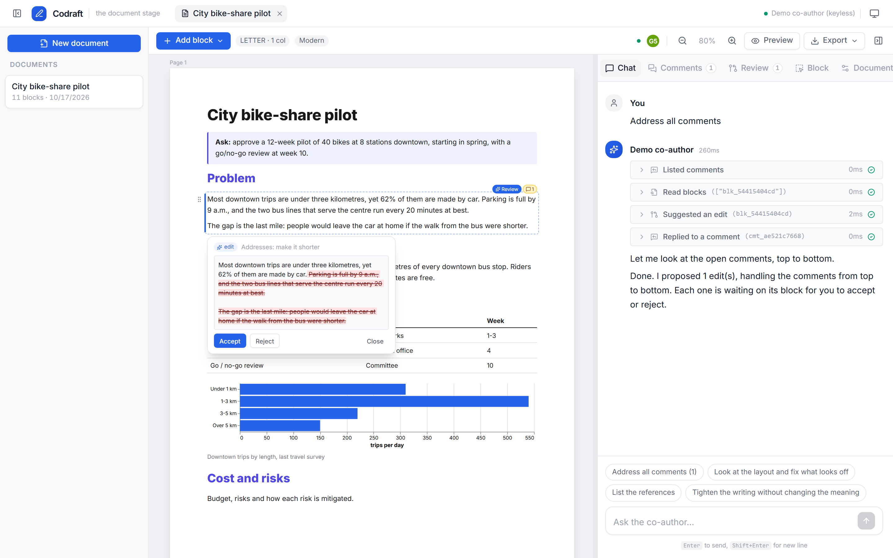
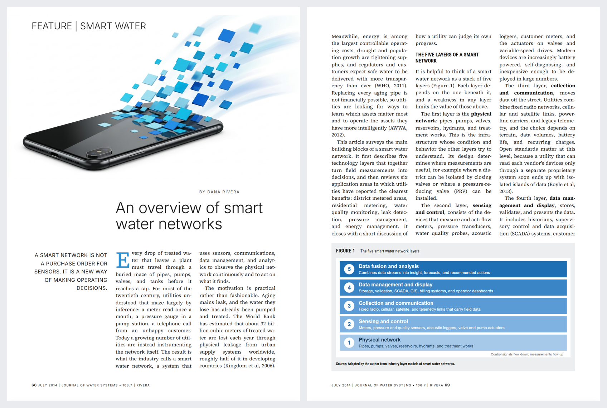
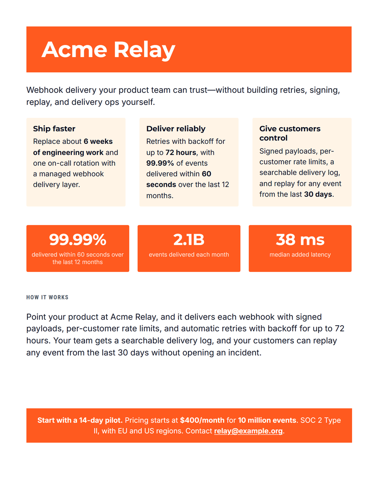

# Documents — `langstage-codraft`

The document stage: write a document block by block on real pages while your LangGraph agent
co-authors it. You own the thinking. The agent owns the styling and helps with drafting and
research. Any change it makes to your text is a suggestion you approve, and you export exactly
what you see.

[:material-github: dkedar7/langstage-codraft](https://github.com/dkedar7/langstage-codraft){ .md-button }
[:material-package: PyPI](https://pypi.org/project/langstage-codraft/){ .md-button }

<figure markdown="span">
  <video width="760" style="max-width:100%; height:auto" controls playsinline preload="none"
         poster="https://dkedar.com/media/codraft/codraft-launch-poster.jpg"
         aria-label="Codraft launch video: leave comments for the agent, review its suggestions as diffs, restyle the document from chat, step through a block's versions, export">
    <source src="https://dkedar.com/media/codraft/codraft-launch.mp4" type="video/mp4">
    <a href="https://dkedar.com/media/codraft/codraft-launch.mp4">Watch the Codraft launch video (MP4)</a>
  </video>
  <figcaption>The 80-second tour: a real run with Claude Sonnet 5, with model waits sped up.</figcaption>
</figure>

## Quickstart

<!-- snippet: run server -->
```bash
pip install langstage-codraft
langstage-codraft check --demo                 # preflight: agent, tools, browser, bundled UI
langstage-codraft run --demo --no-browser      # keyless scripted co-author on http://localhost:8060
```

Export (PDF/PNG/JPG/HTML) and the agent's `view_pages` tool render with headless Chromium. Fetch
it once:

<!-- snippet: skip -->
```bash
langstage-codraft install-browser
```

<figure markdown="span">
  
  <figcaption>"Address all comments": each suggestion waits on its block for you to accept or reject.</figcaption>
</figure>

## What you get

- **Blocks on pages.**
    - Block types: text, headings, images, tables, Vega-Lite charts, callouts, columns of cells
      side by side, number tiles, and a references block that compiles itself.
    - Page sizes: Letter, A4, Legal, A5 or 16:9 slide, in either orientation, with margins and
      1–3 columns.
    - Pageless mode is also available.
- **Flow layout with pinned blocks.**
    - Blocks flow column by column. A full-width block balances the columns above it.
    - A pinned block reserves its rectangle and everything else flows around it. Pins can
      repeat on all, odd, even or chosen pages, which is how headers and logos work.
    - Cover and back pages are exempt from the column rule.
- **Suggestions, not silent edits.** Agent writes arrive as diffs. Approval is on by default;
  auto-apply is a per-document switch.
- **Comments tag the agent.** Queue them for later or ask now. "Address all comments" works
  strictly top to bottom.
- **Version trees per block.** Step back and forward. Editing an old version starts a branch.
  A deleted block can be restored with its history: **Undo** on the toast, or **Document →
  Recently deleted**. The agent can do the same when you ask for something back.
- **Checkpoints (0.11).** Name the text as it is now ("Sent to legal"). Later, see what changed
  since, block by block, and go back: all of it or one block. One is taken before each agent
  turn and each **Accept all**, so accepting thirty suggestions at once has an **Undo**.
  See [Checkpoints](#checkpoints-what-changed-since-and-going-back-011).
- **Redlines for reviewers in Word (0.12).** Export what changed since a checkpoint, or the
  pending suggestions, as a Word file with real tracked changes. A reviewer accepts or rejects
  them in Word without opening Codraft. See [Redline Word export](#redline-word-export-012).
- **Sources per block.** The agent cites as it writes.
- **The agent sees the page.** `view_pages` gives vision models screenshots of the rendered
  pages.
- **The agent sees what it has proposed (0.7).** While its suggestions wait for you, the outline,
  `read_blocks` and `view_pages` show the document as it will be once they are accepted, marked
  as pending. A batch of new blocks stays in the order it was written, and each turn starts with
  a note of what you accepted, rejected or edited since the last one.
- **What you see is what exports.** The preview, PDF, PNG and HTML all come from the editor's
  own renderer. CI compares the editor page and the export pixel for pixel. Word (`.docx`),
  PowerPoint (`.pptx`, editable text boxes where the paginator placed them), and GIF/MP4 page
  slideshows are exported too.
- **Sketch it, get an image.** Draw on an image block; the agent views the sketch and turns it into
  an image with its image tool.
- **Video and GIF blocks**, with poster frames for print.
- **Live collaboration.** Everyone in a document sees each other's selections, changes arrive
  instantly, blocks being edited are soft-locked, and simultaneous edits become version branches.
- **Any agent over MCP.** Claude Code, Cursor or any MCP client can co-author through the same
  approval-gated tools.
- **Light and dark**, with the same design system as the web stage.

## Magazine-quality reports

Upload pages of a report whose look you like, name a topic, and the bundled report-designer agent
(`examples/report_designer.py`: Claude Sonnet 5.5 for writing and layout, a Gemini image model for
art, both via OpenRouter) builds an original report in that style: custom page size, justified
three-column type, drop caps and pull quotes, full-bleed hero art, framed figures with a source
line, running footers with page numbers, and a reference list that flows across columns.

<figure markdown="span">
  
  <figcaption>Built by the agent from reference pages and a one-paragraph brief.</figcaption>
</figure>

<!-- snippet: skip -->
```bash
export OPENROUTER_API_KEY=...
langstage-codraft run --agent examples/report_designer.py:make --approval auto
```

The same styles are in the Block and Document panels for people, and in `set_block_layout` /
`set_document_style` for any agent: `lead`, `pullquote`, `kicker`, `byline`, `footer`, `bio`;
headings `display`, `section`, `rule`, `band`; `figure-box`; `hanging` references; `dark` and
`band` callouts; `cards` rows; `plain` number tiles; drop caps; custom page sizes; page-anchored
pins; and `reserve_area` for deliberate white space.

## Side by side: columns, number tiles and bands (0.8)

A one-pager needs things next to each other: three value props, a row of big numbers, a header
band, a call-to-action box. These are blocks, so they flow with the document, export exactly as
they look, and need no pinning.



The built-in agent (GPT-5.4) laid this page out in three turns, from the one-pager template and
a short brief.

- **Columns** (`row`): 2 to 4 cells side by side, each one Markdown. Cells are equal unless you
  give relative widths. The `cards` style puts each cell in a tinted box.
- **Number tiles** (`stat`): a large value with a small label under it, up to six in a block.
  The `plain` style drops the tinted boxes.
- **Band**: a style for headings and callouts. A band heading is a solid header strip; a band
  callout is a call-to-action box with centred text.
- **Fill**: the colour behind a band, a row's cards or the tiles. It is a theme colour by name
  (`accent`, `text`, `muted`, `heading`, `callout`, `figure`, `rule`) or a hex colour. The text
  on it turns white or dark, whichever reads.

In the editor, use **Add block → Columns** or **Number tiles** and edit the cells or tiles in the
Block panel; **Style → band** and **Fill** are in the same panel. The marketing one-pager
template starts with all of them.

<!-- snippet: skip -->
```json
{"type": "heading", "content": {"text": "Acme Relay", "level": 1},
 "layout": {"span": "full", "variant": "band"}}
{"type": "row", "layout": {"span": "full", "variant": "cards"},
 "content": {"cells": [{"markdown": "### Reliable\n\nRetries for 72 hours."},
                       {"markdown": "### Observable\n\nA searchable delivery log."},
                       {"markdown": "### Fair\n\nPer-customer rate limits."}]}}
{"type": "stat", "layout": {"span": "full"},
 "content": {"items": [{"value": "99.99%", "label": "delivered within 60 seconds"},
                       {"value": "38 ms", "label": "median added latency"}]}}
{"type": "callout", "content": {"markdown": "**Start a 14-day pilot.**"},
 "layout": {"span": "full", "variant": "band", "fill": "#ff5a1f"}}
```

The agent makes them with the tools it already has (`insert_blocks`, `propose_insert`,
`propose_edit`, and `fill` on `set_block_layout`), over MCP too. Its instructions say to use
these, never pins, raw HTML or drawn SVG, for columns, tiles, bands and boxes.

- A row or a set of tiles is one block. It moves to the next column or page as a whole and
  never splits; one taller than a page is flagged as overflow.
- Cells that would be narrower than an inch stack instead, and tiles that don't fit one line
  take two.
- Word export writes a row and the tiles as borderless tables and shades a band. PowerPoint
  shows them as pictures, where the paginator placed them.
- Import never produces these blocks: a Markdown or Word file becomes text, tables and figures.

## Pages without holes, tables and references (0.9)

A second real-model evaluation found documents that were sound but not ready to send: pages
left half empty, tables with literal asterisks, and a reference list that printed working
notes. 0.9 fixes the page mechanics behind those.

- **A long table continues on the next page.** A table block splits between rows, across
  columns and pages, and every continued piece repeats the header row. A split keeps at least
  two rows on each side. A table with a fixed height stays one box.
- **Table cells are Markdown.** A cell takes `**bold**`, `*italic*`, `` `code` ``, links,
  `m^2^`, `CO~2~` and citations. `"total": true` sets the last row as a total.
- **Back-fill.** A chart, picture, row or set of tiles that doesn't fit at the bottom of a page
  lets the text after it, up to the next heading, fill the gap, and opens the next page
  itself. It is on for new documents (Document → *Let text fill the gap before a figure*,
  `"backfill": true`). A document saved before 0.9 keeps its pages until you turn it on.
- **Stick to the bottom of the page.** `"layout": {"anchor": "bottom"}` (Block panel → *Stick
  to the bottom of the page*) puts a call to action, a closing band or a sign-off at the foot
  of the page, with later blocks flowing above it. No pin and no reserved area.
- **Cut-off content is reported.** Content taller than a pinned or fixed-height block is
  flagged in the editor, and `view_pages` names the block to the agent.

### References and citations

A source carries what a reference list prints, and a private note that it doesn't:

<!-- snippet: skip -->
```json
{"key": "rivera2024", "title": "Fleet costs", "authors": "Rivera, A. and Chen, B.", "year": "2024",
 "publisher": "Example Press", "url": "https://example.org/fleet", "note": "supports the cost table"}
```

- `[@rivera2024]` in a text block, a callout, a row cell or a table cell prints as `[2]`,
  linked to entry 2 of the list; `[@rivera2024; @chen2023]` prints as `[2, 1]`.
- Numbers follow first appearance, so they stay right when blocks move.
- The `references` block prints `Authors (Year). Title. Publisher. URL.` in every export.
- `note` is never printed. Before 0.9 it was printed after the title.
- A source without a `key` gets one from its first author and year, shown in the Block panel.

### What the agent does differently (0.9)

- **It sees the figure it drew.** `draw_figure` returns a picture of the figure as it sits on
  the page and a check of its labels: cut off, too small, overlapping or crossed by a line. A
  figure can be redrawn five times in a turn.
- **Sources are not cut to make a page fit.** Deleting the reference list, or a block that
  cites a source, waits for your approval in every approval mode.
- **Web search is part of the default install.** When it is missing, `langstage-codraft check`
  says so and the agent is told not to guess URLs.
- **Length targets are measured.** `get_document`, `read_blocks` and `propose_edit` report word
  counts, so "tighten by a third" is checked against a number.
- **Less is sent to the model.** Tool results from earlier turns are cut down in later turns;
  the thread keeps them whole.

## Bring in a document you already have

Most writing starts from a draft. Import a Markdown (`.md`) or Word (`.docx`) file and it
becomes a Codraft document made of ordinary blocks, which you then edit, restyle and hand to
the agent like any other.

<!-- snippet: skip -->
```bash
langstage-codraft import report.md                       # prints the new document id
langstage-codraft import proposal.docx --template paper  # the template's look, your content
langstage-codraft import notes.md --title "Field notes" --theme modern --split section
```

- **In the editor:** **New document → Import Markdown or Word file**. For a Markdown file with
  pictures, select its image files along with it.
- **Over HTTP:** `POST /api/docs/import` (multipart: `file`, and optionally `title`, `template`,
  `theme`, `settings` as JSON, `split`, and `assets` for the image files). It sits behind the
  same password and cross-site checks as every other write.

| In the file | In Codraft |
|---|---|
| Headings (`#`, Word's `Title` and `Heading 1–6`) | Heading blocks. A leading H1, a front-matter `title:` or Word's Title becomes the document title |
| Paragraphs, lists, block quotes, code | Text blocks, one per paragraph (`--split section` keeps the prose between two headings together) |
| Tables | Table blocks (cells as plain text) |
| A picture on its own | An image block. Embedded pictures and local files are stored with the document; a remote picture stays a link |
| `---` / `***`, `
ewpage`, Word page breaks | Divider and page-break blocks |
| GitHub alerts (`> [!NOTE]`) | Callouts |
| Footnotes | References on the block that cites them, cited as `[@key]` and listed in a References block |
| Reference-style links | Ordinary links |

The template you pick supplies the look and not its placeholder text: with `report` the title
goes on the cover page, with `paper` it runs across both columns.

Imported blocks are the author's content, not agent suggestions, so nothing waits for approval.
The import brings in structure and content, not Word's exact look (upload the file with *match
its look* for that). Whatever it can't represent (a text box, an equation, a picture it couldn't
find) is imported as plain text or left out, and listed: the editor shows the list before it
opens the document, the CLI prints it to stderr (`--json` includes it), and the API returns it
as `import.notes`.

The importer never fetches anything. It reads a Markdown file's pictures only from that file's
own folder (CLI) or from the files sent with it (editor, API), sanitizes SVG, and caps sizes:
25 MB per file, 5,000 blocks, and 300 MB for a Word file once unzipped.

## Bring your own agent

Codraft adds what it needs to your agent, in the same way the web stage adds `display_inline`.
Use the middleware, or export a factory:

<!-- snippet: check -->
```python
from langchain.agents import create_agent
from langstage_codraft import CodraftMiddleware

# A graph: the middleware registers CODRAFT_TOOLS, the co-author prompt, and page images.
graph = create_agent("openai:gpt-5-mini", middleware=[CodraftMiddleware()])


# Or a factory: Codraft calls it with its tools and middleware.
def make(tools, middleware):
    return create_agent("openai:gpt-5-mini", tools=list(tools), middleware=middleware)
```

<!-- snippet: skip -->
```bash
langstage-codraft run --agent my_agent.py:graph          # or my_agent.py:make
langstage-codraft check --agent my_agent.py:graph --live # one real turn through core.verify()
```

A graph without the tools still chats, but it can't touch the document, and `check` says so.
Name the graph (`create_agent(..., name="Juniper")`) and the editor calls the agent by that name
everywhere it would say "agent": Ask Juniper, Suggestions from Juniper, Tag Juniper.
Without `--agent`, Codraft builds a default agent from `--model` or the first API key it finds
(`OPENROUTER_API_KEY` → `anthropic/claude-haiku-5.5`).

Each document is its own agent thread (thread id = document id), stored in SQLite so it
survives restarts. The same agent is also served at `POST /agui` for any AG-UI client.

For a complete agent with its own tools, see the Gallery's
[board update](../gallery/board-update.md): it drafts a quarterly update from the numbers
through `CodraftMiddleware(extra_prompt=...)`, then fixes a figure from a comment, with a
checkpoint showing what changed.

### Any agent, over MCP

<!-- snippet: skip -->
```bash
claude mcp add --transport http codraft http://localhost:8060/mcp   # with `run` going
langstage-codraft mcp --data-dir .codraft                           # stdio, no server needed
```

Every tool takes a `doc_id`; `list_documents` and `create_document` get an agent started.

Over stdio, `view_pages` works without a server too: it uses the one on the configured port if it
is running, and otherwise starts a private in-process renderer the first time the tool is called.
That renderer is stopped when the client disconnects, and on SIGTERM or Ctrl+C, so the server
exits at once and leaves nothing in the client's MCP log.

### The toolset

| Read | Write (approval-gated) | Style (applies directly) | Other |
|---|---|---|---|
| `get_document`, `read_blocks`, `search_document`, `read_upload`, `list_comments`, `get_block_history`, `list_checkpoints`, `changes_since` | `propose_edit`, `propose_insert`, `propose_delete`, `propose_move`, `insert_blocks`, `draw_figure` | `set_block_layout`, `set_document_style`, `set_typography`, `set_cover`, `set_header_footer`, `match_upload_style`, `reserve_area` | `reply_to_comment`, `compile_references`, `view_pages`, `view_sketch`, `view_upload`, `calculate`, `list_deleted_blocks`, `restore_block`, `list_design_history`, `restore_design` |

These go through the same HTTP API and store as the editor, so humans and the agent have the
same powers.

A few of these exist because of what a strong model got wrong when it wrote real documents
(0.7):

- `calculate` does the arithmetic for totals, percentages and table cells, so the figures in a
  document are computed, not guessed.
- `restore_block` brings a deleted block back where it was, with its history. It applies
  immediately in either approval mode, because it only puts the author's own block back.
- `get_document` says what each block style (variant) looks like, so the agent knows what a
  heading style does before it tells you.
- `list_checkpoints` and `changes_since` (0.11) are read-only: the agent can tell you what
  changed since a checkpoint, with a word diff per block, and write the cover note from the
  record. It has no tool to go back to one; that changes your content, so it is yours to do.
- Text is GitHub-flavoured Markdown plus superscript `x^2^` and subscript `H~2~O`. Only
  `~~two tildes~~` strike text out.

## Design the whole document (0.5)

The **Design** tab (and the matching agent tools) covers the look of the whole document. It all
applies to one document and exports exactly as shown.

- **Cover page.**
    - Turn the separate cover off and the title and subtitle open page 1 as a full-width title
      block, with the summary right below.
    - Covers and back pages take a background colour or image and top, middle or bottom
      placement; dark backgrounds get light text.
    - Pin art or a logo to an exact spot.
    - "+ Add to cover" sits above the page. Anything inserted right after a cover block, by a
      person or the agent, joins the cover.
- **Fonts and colours.**
    - Body, heading, title and label fonts; size, line spacing, heading scale, weight and case;
      alignment and hyphenation. Justified text is hyphenated by default, and the editor and the
      PDF break the same words.
    - Text, heading, accent, rule, tint and paper colours, on top of the theme.
    - 17 families are bundled. Any other Google Fonts family loads on demand (`web_fonts`).
    - **Save as theme** keeps the look for every other document.
- **Header and footer.** Left, centre and right text in the margins, with `{page}`, `{pages}`,
  `{title}` and `{year}`. Word export writes them as real header and footer fields.
- **Match a document's look.**
    - Upload a PDF, a Word file or a page image. Codraft applies its page size, margins and
      columns, its fonts, its colours, its cover and its running header and footer.
    - Fonts are mapped to open look-alikes: Calibri → Carlito, Arial → Arimo, Times → Tinos.
    - The agent sees the uploaded pages and refines the rest (`match_upload_style`).

Hosts set what new documents start with through `create_app(..., doc_defaults={...})` or
`[codraft.doc_defaults]`; a theme can also style the cover (`cover_background`, `cover_text`).

### Design history: undo a restyle (0.10)

The agent changes the look without asking, which only works if it is cheap to undo. So the look
has a history, like the text does. Every change to the document settings, typography, cover,
header and footer, block layouts and reserved areas is a **step**, with who made it, when, and
what it changed:

<!-- snippet: skip -->
```text
The agent   3 min ago    1 → 2 columns, theme classic → modern, body font Lato, 14 block layouts
You         1 h ago      heading case uppercase
```

- **One turn is one step.** An agent turn that makes 30 or 200 styling calls is a single step. So
  is one drag of a colour picker. An MCP client has no turns, so its calls are grouped by time.
- **Undo** reverts that step alone and leaves later changes in place. A setting or a block that
  was restyled again since keeps its newer look.
- **Back to before this** puts the document back to how it looked before the step: that step and
  every later change to the look are undone.
- **A restore is a step itself**, so it can be undone the same way.
- **Content is never touched.** A restore changes settings, block layouts and reserved areas. It
  doesn't edit, create or delete content blocks. The exported page after an undo is the page from
  before the restyle, pixel for pixel.

Where to find it:

| Where | What |
|---|---|
| The notice after a turn in which the agent changed the look | what changed, and **Undo** |
| **Design → History** | every step, with **Undo** and **Back to before this**; **Undo the agent's last restyle** at the top |
| The agent, and MCP clients | `list_design_history` and `restore_design`. The agent uses them only when you ask ("undo that", "the old cover was better"), and its next turn is told when you undid its styling |
| REST | `GET /api/docs/{id}/design-history`, `POST /api/docs/{id}/design-history/{step}/restore` (`{"only": true}` undoes that step alone) |
| Python | `Store.design_history(doc_id)`, `Store.restore_design(doc_id, step_id, only=False)` |

The newest 200 steps of each document are kept. The approval mode, the brief and the page count
you asked for are not part of the look, and a restore leaves them alone.

## Checkpoints: what changed since, and going back (0.11)

Every block keeps its own version tree. A **checkpoint** ties the blocks together at a moment, so
you can ask of the whole document "what changed since the version legal reviewed?", and take a
long agent turn back after accepting it wholesale.

<!-- snippet: skip -->
```text
Sent to legal                         You          6 days ago    14 changes since…
Before Accept all (12 suggestions)    You          3 min ago     12 changes since…
Before the agent's turn               The agent    1 h ago       19 changes since…
```

- **Named and automatic.** You name a checkpoint in **Document → Checkpoints**; it is kept until
  you delete it. Codraft takes one itself before each agent turn that proposes content, before
  each **Accept all** and before a restore, and keeps the newest 100. Naming an automatic one
  keeps it.
- **No text is copied.** A checkpoint records which version of each block was showing and where
  the block stood. It is taken at the moment itself, so it is exact even for a block you had
  stepped back to an older version.
- **Changes since** lists the blocks edited, added, deleted and moved, with the word diff a
  suggestion gets and word counts. **Revert this block** takes one block back; **Restore all**
  takes the document back.
- **Going back overwrites nothing.**
    - An edited block checks out the version it had. The newer text stays in its history, one
      step forward.
    - A deleted block returns with its history. A block added since goes to **Recently deleted**.
    - The order is put back.
    - The restore takes a checkpoint first, so **Undo** on the notice undoes it.
    - The exported pages after a restore are the checkpoint's pages, pixel for pixel.
- **Undo accept all.** The notice after **Accept all** offers it, and the Review tab keeps **See
  changes** and **Undo** afterwards. The suggestions stay decided; to re-apply one, step that
  block forward.
- **Content only.** Settings, block layouts and reserved areas have their own
  [history](#design-history-undo-a-restyle-010), and a checkpoint restore leaves them alone.
- **Pending suggestions stay pending.** One written against text that is no longer showing is
  marked outdated. One on a block the restore removed is closed.
- **Other people.** A block someone else is editing right now is left alone and listed, so you
  can revert it afterwards.

Where to find it:

| Where | What |
|---|---|
| **Document → Checkpoints** | name one, see how much changed since each, rename or forget one; **N changes since…** opens the review, with **Revert this block** and **Restore all** |
| The notice after **Accept all**, and the Review tab | **Undo accept all**, **See changes** |
| The agent, and MCP clients | `list_checkpoints` and `changes_since`, both read-only. Going back is the author's |
| REST | `GET`/`POST /api/docs/{id}/checkpoints`, `PATCH`/`DELETE …/checkpoints/{cid}`, `GET …/checkpoints/{cid}/changes`, `POST …/checkpoints/{cid}/restore` (`{"blocks": [...]}` for some of them). `POST …/suggestions/accept-all` returns the `checkpoint` that undoes it |
| Python | `Store.create_checkpoint(doc_id, name)`, `Store.list_checkpoints(doc_id)`, `Store.checkpoint_changes(doc_id, checkpoint_id)`, `Store.restore_checkpoint(doc_id, checkpoint_id, blocks=None)` |

<!-- snippet: skip -->
```python
cp = httpx.post(f"{base}/api/docs/{doc_id}/checkpoints", json={"name": "Sent to legal"}).json()
# ... a week of edits and accepted suggestions ...
ch = httpx.get(f"{base}/api/docs/{doc_id}/checkpoints/{cp['id']}/changes").json()
ch["counts"]        # {"edited": 11, "added": 2, "deleted": 1, "moved": 0, "total": 14}
got = httpx.post(f"{base}/api/docs/{doc_id}/checkpoints/{cp['id']}/restore", json={}).json()["result"]
httpx.post(f"{base}/api/docs/{doc_id}/checkpoints/{got['undo']}/restore", json={})   # undo that
```

A data directory from an earlier version opens as before. Its documents have no checkpoints until
one is taken.

### Redline Word export (0.12)

Legal reviewed the version you sent and now asks for a redline against it. They work in Word,
so **Changes since…** inside Codraft doesn't reach them, and a plain Word export is a clean copy.
A **redline** is the Word export with the changes written as Word's own tracked changes, so the
reviewer gets Word's **Accept** and **Reject**.

<!-- snippet: skip -->
```bash
langstage-codraft export DOC_ID -f docx --since "Sent to legal" -o redline.docx   # a checkpoint's name or id
langstage-codraft export DOC_ID -f docx --pending -o suggestions.docx             # the pending suggestions
```

In the editor, the file icon next to a checkpoint's **N changes since…** (or **Export redline** in
its changes view) downloads `<title>-redline.docx`. **Export → Word with suggestions** downloads
`<title>-suggestions.docx`, with each pending suggestion as a tracked change by the agent.

| Change | In Word |
|---|---|
| Edited text, heading or callout | word by word, with bold, italic and links kept |
| A paragraph added to or removed from a block | the whole paragraph inserted or deleted |
| Added or deleted block | inserted where it is now, or deleted where it was |
| Moved block | Word's **Moved** marks, from where it was to where it is now; Accept or Reject takes both places at once (0.12.1). Moved and edited too: the edit is word by word inside the move |
| Edited table, row, stat tiles, chart or image | the old block deleted, the new one inserted |
| Moved table | deleted where it was, inserted where it is now (Word has no move marks for tables) |

Each change carries its author and date from the version records: a collaborator's name, the
agent's name, or "Author". Accept every change and the text reads as the document does now;
reject every one and it reads as it did at the checkpoint. A chart or image as it was has no
picture to show, so the redline names it (`[chart]`) next to its caption. Reviewers' tracked
changes don't come back into Codraft.

The same files come from `GET /api/docs/{id}/export?format=docx&since=<checkpoint>` (or
`&pending=true`) and, in Python, from `export_document(data_dir, doc_id, "docx", since=...)` or
`pending=True`.

## Configuration

The usual chain applies: defaults < `langstage.toml` < `LANGSTAGE_*` env < flags.
`langstage-codraft run --show-config` prints each value and its source.

<!-- snippet: check -->
```toml
[agent]
spec = "my_agent.py:graph"

[codraft]
model = "openrouter:anthropic/claude-haiku-5.5"
max_output_tokens = 16000      # the most the built-in agent writes per model call
reasoning = "auto"             # auto | off | low | medium | high
approval = "required"          # default for new documents; or "auto"
default_theme = "acme"
allowed_themes = ["acme", "academic"]
templates_dir = "templates"    # *.json files: settings + a block skeleton
data_dir = ".codraft"

[codraft.themes.acme]
label = "Acme"
font_body = "Inter, system-ui, sans-serif"
color_accent = "#d9480f"
```

`max_output_tokens` and `reasoning` apply to the built-in agent (0.7). The cap keeps a gateway
from reserving the model's whole output window on every call, which fails outright on a key with
little credit. `reasoning = "auto"` turns reasoning on at low effort where Codraft knows the
model's switch (OpenRouter models, OpenAI GPT-5 and o-series, Anthropic). For OpenAI's GPT-5 and
o-series models the agent uses the Responses API, the one place they reason together with tools;
this needs `langstage-core` 1.0.64. If the provider refuses the setting, the agent carries on
without it and logs why.

Built-in themes: classic, modern, academic, minimal, bold. Built-in templates: blank, report,
proposal, memo, academic paper (two columns), marketing one-pager (a row of value props, number
tiles and a call-to-action band), and newsletter (three columns with a repeating masthead).

New documents capture the author's brief: writing style, objective, platform, audience, language
and output format. Uploads can serve as searchable reference material or as a template to
scaffold from.

### Branding and embedding (0.4)

The app chrome (not the documents) takes the `[ui]` keys it shares with langstage-web:
- `title`, `subtitle`, `agent_name`, `welcome_message`, `icon_url`
- `font_family`, `font_url`, `starter_prompts`, `custom_css`, `embedded`
- `[ui.colors]` and `[ui.colors_dark]`, which override any design token
- `[ui.features]`, which turns off `chat`, `mcp`, `doc_list` or `theme_toggle`. Since 0.5.3,
  `mcp = false` also stops serving `/mcp`. `chat = false` only hides the chat panel: the agent's
  buttons still use the chat endpoint.

To host Codraft inside another FastAPI app, call
`mount(host, "/write", create_app(cfg, graph, ui={...}))`.

Behind a proxy, set two things:
- `proxy_secret`: the proxy sends it as `X-Codraft-Proxy-Secret`. It can also send its public path as `X-Forwarded-Prefix`.
  The prefix must be a plain URL path such as `/apps/codraft`. Anything else, such as `//host`, is
  ignored (since 0.12.5). Have the proxy set or clear the header itself rather than pass on the
  client's.
- `user_header` (for example `X-User-Email`): the header that names the user on edits and presence.

`auth_username` and `auth_password` turn on HTTP basic auth, on its own or together with the proxy
secret (both are checked since 0.5.3). Since 0.5.2 it applies to
requests from the same machine too, so it still protects Codraft behind a same-host reverse proxy.
The export renderer sends the password itself. Codraft also refuses state-changing requests that a
browser sends from another website, as langstage-web does. Adding `?embed=1` to the URL hides
Codraft's own brand and theme toggle.

A relative `custom_css` path in `langstage.toml` resolves against that file's folder.

Since 0.5.4, `langstage-codraft run` on a loopback address refuses requests addressed to other
host names, as langstage-web does (see [Host names](web.md#host-names)). It reads the same
`[server] allowed_hosts` / `LANGSTAGE_ALLOWED_HOSTS`. An app that mounts Codraft with
`create_app()` isn't checked unless it passes `host_guard=True`.

A host can also set a house style for documents:
- `create_app(..., doc_themes={...})` adds document themes in code.
- `default_theme` and `default_page_size` apply to new documents, including documents from the
  built-in templates that use the generic look.

In an `<iframe>`, Codraft sends the host page two messages via `postMessage`:
- `codraft:location` names the open document, so the host can deep-link it.
- `codraft:auth-required` means the host's session expired.

Codraft also navigates with `replaceState`, so the host's Back button leaves the page.

Codraft runs inside Lighthouse this way, as the Lab's **Write** bench. It uses SWAN's report house
style through `doc_defaults`: no separate cover, SWAN margins, and a footer with the page number,
title and copyright. Its graph is named "Lighthouse", so the editor calls the agent Lighthouse
throughout.

## CLI

<!-- snippet: skip -->
```bash
langstage-codraft run [--agent SPEC | --model SPEC | --demo] [--port 8060] [--approval auto]
langstage-codraft check [--live] [--json]
langstage-codraft new "Title" --template report
langstage-codraft import FILE.md|FILE.docx [--title T] [--template ID] [--theme NAME] [--split paragraph|section] [--json]
langstage-codraft list
langstage-codraft export DOC_ID... -f pdf|docx|pptx|png|jpg|html|gif|mp4 -o out.pdf [--data-dir DIR]
langstage-codraft mcp [--data-dir DIR]                            # Codraft over MCP (stdio)
langstage-codraft install-browser
```

### Export without a running server

`export` doesn't need `langstage-codraft run` in the background. Point it at the data directory and
it renders in-process, so a batch job or CI step is one command:

<!-- snippet: skip -->
```bash
langstage-codraft export doc_6e07ed1cea -f pdf -o report.pdf --data-dir .codraft

# several documents and formats share one browser launch; -o is then a directory
# (a directory works for one document too: -o out/ writes out/<title>.pdf)
langstage-codraft export doc_6e07ed1cea doc_9a41c2d07b -f pdf -f png -o out/ --data-dir .codraft
```

A file is named after the document's title: lower case, words joined by `-`, at most 60
characters. Accented Latin letters lose only their accents (`rapport-d-activite-2026.pdf`), and
other scripts keep their letters (`日本の報告.pdf`, `отчёт-за-год.pdf`). Since 0.12.7, the
download from the editor's **Export** menu has the same name. Earlier versions dropped
accented letters and named non-Latin titles `document.pdf`.

It is the same renderer. The command starts the Codraft app inside its own process, prints through
the page route the editor's Export button uses, and shuts down, so the output matches a running
server's. That in-process app listens on `127.0.0.1` only, on a port the OS picks, and every request
to it needs a one-off password made for that run. It is safe to run while a server is using the same
data directory.

| You pass | It exports |
|---|---|
| `--data-dir DIR` or `--standalone` | in-process, from that data directory (`--standalone`: the configured one) |
| `--port` or `--url` | through that running server |
| neither | through the server on the configured port if one is running, else in-process |

From Python:

<!-- snippet: skip -->
```python
from langstage_codraft import Standalone, export_document

pdf = export_document(".codraft", "doc_6e07ed1cea", "pdf")                  # bytes
export_document(".codraft", "doc_6e07ed1cea", "docx", "out/report.docx")   # writes the file

with Standalone(".codraft") as codraft:       # one browser for many exports
    for doc_id in ("doc_6e07ed1cea", "doc_9a41c2d07b"):
        open(f"{doc_id}.pdf", "wb").write(codraft.export(doc_id, "pdf"))
```

PNG and JPG come back as the image for a one-page document and as a zip of page images otherwise;
HTML is always a zip. A failed export raises `ExportError` (`.status` 404 for an unknown document,
503 when Chromium isn't installed).

### Cut-off content (0.9.1)

A block whose content is taller than the fixed height, or the pin's box, it was given is cut off
on the page, and so is a block pinned partly or wholly off the page, and what doesn't fit is missing from the export. Two things keep that from happening
unnoticed:

- **The agent can't do it.** `set_block_layout` measures the block in the print view and refuses a
  height or a box that would cut off its text, table or cells. The refusal names the height the
  content needs. Shortening a block is a content change, and that is a suggestion you approve. Since
  0.12.4 it also refuses a pin that would put a text block even partly off the page (an image may
  bleed, as long as most of it stays on the page), or onto a page past the last one. The check is
  in the tool, so MCP clients and bring-your-own agents get it too.
- **An export says what it cut off.** You can still give a block any height in the Block panel
  (the panel says how much is cut off and offers **Fit the content**). Every way to export then
  reports it:

<!-- snippet: skip -->
```console
$ langstage-codraft export doc_6e07ed1cea -o report.pdf --data-dir .codraft
[ ok ] wrote report.pdf (48213 bytes)
[warn] doc_6e07ed1cea: 1 block is cut off in report.pdf, so part of the content does not print: blk_2b4f2daac7 (page 2). ...
$ langstage-codraft export doc_6e07ed1cea -o report.pdf --data-dir .codraft --strict   # exit 1, nothing written
```

| Where | What you get |
|---|---|
| `langstage-codraft export` | a `[warn]` line per file; `--strict` fails the document (exit 1, no file); `--json` prints one object per export with `cut_off` |
| `GET /api/docs/{id}/export` | the header `X-Codraft-Cut-Off: blk_…@page,…`; `?strict=true` answers 409 with the list |
| `GET /api/docs/{id}/layout-check` | `{"ok": false, "cut_off": [{"block_id", "page", "type", "natural_px", "box_px", "preview"}]}` |
| `export_document`, `Standalone.export` | a `CutOffWarning`; `strict=True` raises `ExportError` (`.status` 409); `Standalone.check(doc_id)` returns the list |
| the editor's Export button | a notice naming the page, with **Show** to open the block |

A Word export has no such warning, because Word reflows the text itself.
